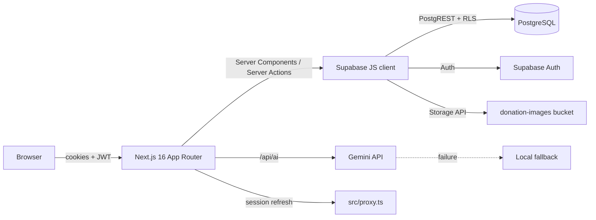

# Salo

**Share a meal. Rescue a plate.**

Salo is a community food-sharing and rescue platform for local donors, receivers, and admins. Donors post surplus food with photos and pickup details, approved neighbors reserve it, and a private six-character code confirms the handover. Admins approve members, moderate listings and reports, and watch the rescue analytics.

Built as the **WS-101 semi-final full-stack project** with Next.js 16, Supabase (PostgreSQL + Auth + Storage), and Gemini.

> **Live demo note:** this repository contains no credentials. Create your own Supabase project (hosted or Docker) and add a local `.env.local` before running. See [Quick start](#quick-start).

---

## Contents

- [What it does](#what-it-does)
- [Feature map](#feature-map)
- [Tech stack](#tech-stack)
- [Quick start](#quick-start)
  - [Option A — hosted Supabase](#option-a--hosted-supabase-recommended-for-the-online-demo)
  - [Option B — Supabase with Docker](#option-b--supabase-with-docker-required-for-the-defense)
  - [Create the first admin](#create-the-first-admin)
  - [Enable Gemini](#enable-gemini)
- [Demo walkthrough](#demo-walkthrough)
- [Scripts](#scripts)
- [Architecture at a glance](#architecture-at-a-glance)
- [Security model](#security-model)
- [Project structure](#project-structure)
- [Testing and verification](#testing-and-verification)
- [Deployment notes](#deployment-notes)
- [Documentation index](#documentation-index)
- [Credential hygiene](#credential-hygiene)

---

## What it does

Food rescue usually fails at the handover: good food is available, but nobody knows where it is, whether it is safe, or who is supposed to collect it. Salo closes that loop.

| Step | Who | What happens |
| --- | --- | --- |
| 1. Share | Donor | Posts food name, description, category, quantity, use-by date, pickup address/window, allergens, and an optional photo. Gemini can draft the description, suggest a category, estimate shelf life, and flag risk. |
| 2. Discover | Receiver | Searches available food by text, category, or soonest expiry. Listings are only visible to signed-in, approved members. |
| 3. Reserve | Receiver | The database atomically marks the donation `reserved` and issues a private six-character pickup code. |
| 4. Hand over | Donor + receiver | At pickup, either participant enters the code. The database marks the reservation and donation `picked_up`, records the timestamp, and notifies both members. |
| 5. Moderate | Admin | Approves/suspends accounts, removes fake or unsafe listings, resolves reports, and reads rescue analytics. |

### Feature map

| Area | Delivered |
| --- | --- |
| Accounts | Email/password registration, login, logout, email-confirmation callback, pending/rejected/suspended screen, role selection (donor or receiver) |
| Access control | Admin approval queue; only approved members can post or reserve; admins cannot reserve; RLS on every table |
| Donations | Create with validated fields and optional photo, browse/search/filter/sort/paginate, detail page, donor history, donor withdrawal while available |
| Reservations | Atomic reserve, private pickup code, pickup confirmation by code, cancellation, double-reserve prevention, expired-food guard |
| Notifications | In-app notification bell and page for reservations, cancellations, pickups, reports, removals, and account decisions; mark one/all read |
| Reports | Members report unsafe food, fake listings, wrong information, offensive content, no-shows, or other issues; duplicate open reports are prevented |
| Admin | Overview analytics (members, live listings, rescues, servings/kg, six-month activity, category mix), member management, donation moderation, report queue |
| AI | Gemini structured-output tasks for description, category, shelf life, and safety screening; Zod validation; rate limit; deterministic local fallback. Persisted risk/shelf-life metadata is re-derived by the database from the saved listing, never from hidden form fields. |
| Storage | Public `donation-images` bucket, writes restricted to each member's own folder, 5 MB image limit, JPG/PNG/WebP only |
| Quality | TypeScript strict mode, Zod validation at every write boundary, 33 unit tests, 41 PGlite schema/RLS/RPC checks, lint/build gates |

### Roles

- **Donor** — restaurants, bakeries, organizations, or households with surplus food. Can post, view their history, see who reserved, confirm pickup, withdraw an available listing, and report other listings.
- **Receiver** — neighbors, students, families, or community pantries. Can browse, reserve, view their reservations, confirm pickup, cancel, and report.
- **Admin** — trusted community manager. Can approve/reject/suspend accounts, remove donations, resolve reports, and read analytics. Cannot reserve food, so moderation and participation stay separate.

New accounts start as `pending`. The first admin is promoted once through SQL; every later member is approved from the admin dashboard.

---

## Tech stack

| Layer | Choice |
| --- | --- |
| Framework | Next.js **16.4.3** App Router, React **19.3**, TypeScript |
| Styling | Tailwind CSS **4** with a custom cream/leaf/clay design system |
| Backend | Supabase: PostgreSQL, Auth, Storage, PostgREST, RLS |
| Supabase SSR | `@supabase/ssr` cookie sessions; `src/proxy.ts` refreshes sessions |
| AI | `@google/genai` with `gemini-flash-latest` (configurable) and structured JSON schemas |
| Validation | Zod 4 + database `CHECK` constraints |
| Icons | Lucide |
| Tests | Vitest 5 (domain/validation) + PGlite (schema, RLS, RPC workflows) |

Why these choices: [docs/adr/](docs/adr/).

---

## Quick start

### Prerequisites

- Node.js 20+ (Node 22/24 recommended)
- npm
- A Supabase project **or** Docker Desktop + Supabase CLI for the local stack
- Optional: a Gemini API key from [Google AI Studio](https://aistudio.google.com/apikey)

```bash
git clone <your-repository-url> salo
cd salo
npm install
cp .env.example .env.local
```

Then choose **Option A** (fast online demo) or **Option B** (Docker, required for the defense).

### Option A — hosted Supabase (recommended for the online demo)

1. Create a project at [supabase.com/dashboard](https://supabase.com/dashboard).
2. Open **Project Settings → API** and copy:
   - **Project URL** → `NEXT_PUBLIC_SUPABASE_URL`
   - **anon public** key → `NEXT_PUBLIC_SUPABASE_ANON_KEY`
   - Never use the `service_role` key in this app.
3. In **SQL Editor**, run the migration and seed **in this order**:
   - `supabase/migrations/20261027000000_init.sql`
   - `supabase/seed.sql`
4. In **Authentication → URL Configuration**:
   - Site URL: `http://localhost:3000` for local development, or your deployed origin.
   - Redirect URLs: add `http://localhost:3000/auth/callback`, `http://127.0.0.1:3000/auth/callback`, and your deployed `/auth/callback` URL.
5. For a fast classroom demo, turn **Authentication → Providers → Email → Confirm email** off. With confirmations on, the app sends users through `/auth/callback` and they can still sign in after confirming.
6. Set `NEXT_PUBLIC_SITE_URL` in `.env.local` to the exact origin you open in the browser.
7. Start the app:

```bash
npm run dev
# http://localhost:3000
```

If the app opens `/setup`, Supabase is not configured or the migration has not run.

### Option B — Supabase with Docker (required for the defense)

The Supabase CLI runs the local Supabase stack (PostgreSQL, Auth, Storage, PostgREST, Studio, and supporting services) as Docker containers. This is the self-hosted setup used for the defense demonstration.

1. Install Docker Desktop and start it. Verify with `docker info`.
2. Install the Supabase CLI if it is not already available:

```bash
npm install --save-dev supabase
# or use npx supabase ... without installing
```

3. From the repository root:

```bash
npx supabase start      # pulls and starts the Docker services
npx supabase db reset   # applies migrations + seed.sql
npx supabase status     # prints API URL, anon key, Studio URL
```

4. Copy the **API URL** and **anon key** printed by `supabase status` into `.env.local`:

```dotenv
NEXT_PUBLIC_SUPABASE_URL=http://127.0.0.1:54321
NEXT_PUBLIC_SUPABASE_ANON_KEY=<anon key from supabase status>
NEXT_PUBLIC_SITE_URL=http://localhost:3000
```

5. Confirm the containers and services:

```bash
docker ps
# Studio: http://127.0.0.1:54323
# API:    http://127.0.0.1:54321
```

6. Start Next.js with `npm run dev` and open `http://localhost:3000`.

Useful local commands:

```bash
npx supabase stop          # stop containers, keep data
npx supabase stop --no-backup  # stop and discard local data
npx supabase db reset      # rebuild schema + seed
npx supabase migration list
```

`supabase/config.toml` already enables Auth, Storage, Realtime, Studio, and the email testing server, disables email confirmation locally, and allows the local `/auth/callback` redirects. Local emails appear in **Mailpit** at `http://127.0.0.1:54324`.

> Docker is not required for the hosted demo. The defense guidelines ask for a self-hosted Supabase + Docker demonstration, so use Option B when presenting the architecture and show `docker ps` / Studio.

### Create the first admin

Registration intentionally does not offer an `admin` role. Bootstrap exactly one admin after registering normally:

1. Register at `/register` (choose **receiver**).
2. In the Supabase SQL Editor (hosted) or Studio SQL Editor (Docker), run:

```sql
update public.profiles
set role = 'admin', status = 'approved'
where email = 'you@example.com';
```

3. Sign out and back in, then open `/admin`.

Every subsequent account is approved from **Admin → Members**. The database refuses an admin trying to suspend their own account.

### Enable Gemini

1. Create an API key in [Google AI Studio](https://aistudio.google.com/apikey).
2. Add it to `.env.local`:

```dotenv
GEMINI_API_KEY=...
GEMINI_MODEL=gemini-flash-latest
```

3. Restart `npm run dev` after changing environment variables.

If the key is missing, invalid, rate-limited, or Gemini returns malformed JSON, the app **does not break**. It falls back to a conservative local screen (`src/lib/ai/fallback.ts`) and labels the result as local guidance in the UI.

The assistant's draft and screen are suggestions shown before posting. When the donor submits, the database re-derives the stored risk level, notes, and shelf life from the saved title/description/category in `attach_donation_assessment()`. A tampered hidden field or a direct PostgREST insert cannot mark unsafe food as low risk; the donor insert policy requires all assistant columns to be empty.

> AI output is decision support only. It never certifies food as safe, and the donor/receiver remains responsible for inspection and local food-safety rules.

---

## Demo walkthrough

A complete demo takes about 8–10 minutes. No credentials are committed; create these accounts locally.

| Account | Role | How to create |
| --- | --- | --- |
| `admin@example.com` | Admin | Register as receiver, then run the promotion SQL above |
| `maria@example.com` | Donor | Register as donor, approve from Admin → Members |
| `juan@example.com` | Receiver | Register as receiver, approve from Admin → Members |

Suggested sequence:

1. **Landing page** — problem, roles, AI safety promise.
2. **Register** a new receiver. Show the `/pending` screen and explain the approval gate.
3. **Admin** — approve the receiver and point out the pending-account notification.
4. **Donor** — post “Vegetable adobo” with a photo, quantity, use-by date, and pickup window. Click **Draft description & category**, then **Run a safety screen**. Show the AI source badge (`Gemini`, `Part local`, or `Local fallback`). After posting, point out that the stored safety screen is re-derived by the database from the saved listing.
5. **Browse** — search “adobo”, filter by category, sort by soonest expiry. Open the listing.
6. **Receiver** — reserve the food. Show the six-character pickup code and the donor's notification.
7. **Donor** — enter the code at handover; show both histories change to `picked_up` and both notifications arrive.
8. **Report** — from a second receiver, report a listing as fake. Show the duplicate-report guard.
9. **Admin** — open the report queue, remove the listing, show that the report auto-resolves and the donor/receiver are notified.
10. **Analytics** — show rescues, servings/kg, six-month activity, and live categories in `/admin`.
11. **Database proof** — open Supabase Studio (Docker) or Table Editor and show the new rows in `donations`, `reservations`, `notifications`, and `reports`.

Detailed script, timing, and Q&A: [docs/PRESENTATION.md](docs/PRESENTATION.md).

---

## Scripts

| Command | Purpose |
| --- | --- |
| `npm run dev` | Start the Next.js development server |
| `npm run build` | Production build |
| `npm run start` | Serve the production build |
| `npm run lint` | ESLint (Next.js config) |
| `npm run test` | Run Vitest once |
| `npm run test:watch` | Vitest watch mode |
| `npm run verify:db` | Apply the migration + seed to PGlite and run 41 RLS/RPC checks |
| `npm run typecheck` | `tsc --noEmit` |
| `npx supabase start` | Start local Supabase Docker services |
| `npx supabase db reset` | Reapply migrations + seed |
| `npx supabase status` | Show local API URL, keys, and Studio URL |

---

## Architecture at a glance



Key points:

- **Server Components** load data with the caller's JWT. `src/lib/queries.ts` is the read layer.
- **Server Actions** in `src/actions/` validate input with Zod, call Supabase, revalidate paths, and return a typed `ActionResult`.
- **Proxy** (`src/proxy.ts` → `src/lib/supabase/proxy.ts`) refreshes cookies and performs optimistic redirects. It is not the authorization boundary.
- **PostgreSQL RLS** is the final authority. The app never uses a service-role key.
- **RPCs** (`SECURITY DEFINER`) own multi-row transitions: reserve, confirm pickup, cancel reservation, withdraw, attach the server safety assessment, admin removal, account status changes, and report resolution.
- **Gemini** is called only from the server-side `/api/ai` route, requires an approved session, is rate-limited to 12 requests/minute/member, and validates output with Zod. The persisted safety assessment is derived again by SQL from the saved listing.

Full walkthrough: [docs/ARCHITECTURE.md](docs/ARCHITECTURE.md).

---

## Security model

| Risk | Control |
| --- | --- |
| Unauthorized data access | RLS enabled on all six domain tables + storage objects |
| Shared secret leak | Only the anon key is used; no service-role key in the repository or runtime |
| New-account abuse | `pending` by default; admin approval required before posting/reserving |
| Double reservation | Partial unique index `reservations_one_active_per_donation` + `SELECT … FOR UPDATE` in `reserve_donation` |
| Pickup fraud | Six-character code stored on the reservation; only participants/admin can confirm; code compared server-side |
| Self-dealing | `receiver_id <> donor_id` constraint + checks in app and RPC; admins cannot reserve |
| Expired food | DB trigger blocks past use-by dates while available/reserved; RPC rechecks at reservation time |
| Fake/unsafe listings | Member reports, unique open report per member/listing, admin removal with reason and notifications |
| Image abuse | Public read bucket, writes restricted to `auth.uid()` folder, 5 MB limit, MIME allow-list |
| Injection in search | `sanitizeSearchTerm` removes PostgREST separators/wildcards; parameterized queries via Supabase |
| AI hallucination | Facts-only system prompt, JSON response schema, Zod parser, conservative fallback, explicit “not certification” UI |
| Forged AI metadata | Persisted risk/shelf-life is derived by a `SECURITY DEFINER` RPC from the saved listing; donor inserts must leave assistant columns empty, and donors have no direct update policy |
| AI abuse | Auth + approved-profile check + sweeping 12/min in-memory rate limit + input length limits |
| Sensitive logs | Server logs keep technical errors; UI receives friendly messages via `friendlyError` |

Report-level details: [docs/DATABASE.md](docs/DATABASE.md).

---

## Project structure

```text
.
├─ src/
│  ├─ app/
│  │  ├─ (auth)/              login, register, pending; shared auth layout
│  │  ├─ (app)/               approved-member shell: browse, donations, dashboard,
│  │  │                       notifications, report, admin
│  │  ├─ api/ai/              authenticated Gemini route
│  │  ├─ auth/                callback + signout route handlers
│  │  ├─ setup/               first-run configuration guide
│  │  ├─ page.tsx             public landing page
│  │  └─ layout.tsx           metadata, skip link, global CSS
│  ├─ actions/                server actions: auth, donations, reservations,
│  │                          reports, notifications, admin
│  ├─ components/             UI system, forms, cards, header, admin controls
│  ├─ lib/
│  │  ├─ ai/                  Gemini tasks, Zod parsers, local fallback, types
│  │  ├─ domain/              pure reservation policy (test seam)
│  │  ├─ supabase/            browser/server clients + proxy session refresh
│  │  ├─ auth.ts              requireUser / requireApprovedUser / requireAdmin
│  │  ├─ queries.ts           server-side read layer + admin analytics
│  │  ├─ validation.ts        Zod schemas + search sanitization
│  │  ├─ types.ts             domain types and constants
│  │  └─ database.types.ts    generated Supabase table types
│  └─ proxy.ts                Next 16 proxy entry (session refresh)
├─ supabase/
│  ├─ config.toml             local Docker stack configuration
│  ├─ migrations/20261027000000_init.sql
│  └─ seed.sql                8 food categories
├─ scripts/verify-db.mjs      PGlite schema/RLS/RPC verification
├─ tests/                     33 Vitest tests
├─ docs/                      spec, architecture, database, ADRs, evidence, deck
├─ .scratch/salo/             tracer-bullet ticket record
├─ .env.example               placeholders only
└─ next.config.ts             dynamic session app, 6 MB action limit
```

### Request flow examples

**Browse**

`GET /browse` → `src/proxy.ts` refreshes cookies → `(app)/layout.tsx` requires an approved profile → `browse/page.tsx` parses filters → `listAvailableDonations` queries PostgREST → RLS returns only available, unexpired listings → cards render.

**Reserve**

`ReserveForm` → `reserveDonationAction` → Zod + pure policy check → `supabase.rpc("reserve_donation")` → row lock, rechecks, inserts reservation, flips donation to `reserved`, notifies donor, returns pickup code → revalidate paths → UI shows the code.

**Pickup**

`PickupCodeForm` → `confirmPickupAction` → Zod → `confirm_pickup` RPC → verifies participant and code, updates both rows, notifies both → histories and dashboard refresh.

**AI**

`DonationForm` → `POST /api/ai` → Supabase session + approved check → rate limit → `runAiTask` → Gemini JSON schema → Zod → fallback on any failure → JSON result with `source: "gemini" | "fallback"`. On submit, `createDonationAction` inserts no assistant metadata; `attach_donation_assessment()` derives and stores a conservative screen from the saved listing.

---

## Testing and verification

```bash
npm test
npm run verify:db
npm run typecheck
npm run lint
npm run build
```

Current results at documentation time:

- **Vitest:** 5 files, **33 tests passing**
- **TypeScript:** no errors
- **ESLint:** no warnings
- **Production build:** all routes compiled
- **PGlite integration harness:** migration + seed applied to a real PostgreSQL engine (WASM) with Supabase auth/storage stubs; **41 workflow/RLS checks passing**, including server-derived AI metadata, direct-insert/patch rejection, double-reserve prevention, pickup-code validation, withdrawal locking, report-target consistency, reporter notifications, completed-rescue protection, suspension, and removed-listing visibility.

What is tested where:

| Seam | Tests |
| --- | --- |
| Pure reservation policy | `tests/reservation-policy.test.ts` — approval, admin, self-reserve, status, expiry |
| Validation schemas | `tests/schemas.test.ts` — registration, donation, pickup code, reports |
| Search sanitization | `tests/search.test.ts` — PostgREST separators, wildcard-only, length cap |
| AI fallback | `tests/food-safety.test.ts` — raw meat, dry goods, allergen reminder |
| Safe redirects | `tests/safe-next.test.ts` — same-origin paths, protocol-relative URLs, backslashes, control characters |
| Database/RLS/RPC | `npm run verify:db` — PGlite harness in `scripts/verify-db.mjs` (see [docs/EVIDENCE.md](docs/EVIDENCE.md)) |

The PGlite harness stubs only the Supabase-managed `auth`/`storage` schemas. The SQL it validates is the committed migration. It is reproducible with `npm run verify:db`.

---

## Deployment notes

The app is a standard Next.js server deployment and needs a Node runtime (not static export) because it uses cookies, Server Actions, and route handlers.

1. Deploy to Vercel, a Node host, or a container.
2. Set `NEXT_PUBLIC_SUPABASE_URL`, `NEXT_PUBLIC_SUPABASE_ANON_KEY`, `NEXT_PUBLIC_SITE_URL`, and optionally `GEMINI_API_KEY` / `GEMINI_MODEL`.
3. Add the production `/auth/callback` URL to Supabase Auth redirect URLs.
4. Run the migration + seed against the production database.
5. Promote the first admin.
6. Keep the service-role key out of the deployment environment unless a separate trusted job truly needs it. This app does not.

For a fully self-hosted production Supabase deployment, point the same environment variables at your Supabase gateway URL and anon key, and apply the SQL migration. The app does not depend on Supabase Cloud-specific features.

---

## Documentation index

| Document | What it covers |
| --- | --- |
| [docs/SPEC.md](docs/SPEC.md) | Problem, users, user stories, functional decisions, acceptance criteria |
| [docs/ARCHITECTURE.md](docs/ARCHITECTURE.md) | System context, module map, request flows, Next.js/Supabase/Docker topology |
| [docs/DATABASE.md](docs/DATABASE.md) | ERD, tables, relationships, RLS matrix, RPCs, triggers, storage, setup |
| [docs/EVIDENCE.md](docs/EVIDENCE.md) | Matt Pocock skills, prompts, TDD, debugging, verification, provenance |
| [docs/PRESENTATION.md](docs/PRESENTATION.md) | Slide outline, live demo script, screenshot checklist, Q&A bank |
| [GLOSSARY.md](GLOSSARY.md) | Shared domain vocabulary |
| [docs/adr/](docs/adr/) | Architecture decision records |
| [.scratch/salo/](.scratch/salo/) | Tracer-bullet ticket record mapped to the delivered slices |
| [docs/screenshots/README.md](docs/screenshots/README.md) | Screenshot capture list for the defense |

---

## Credential hygiene

This repository is designed to be submitted without secrets:

- `.env.local` is ignored; only `.env.example` with placeholders is committed.
- No service-role key, database password, JWT secret, or Gemini key appears in source, SQL, docs, or screenshots.
- `.env*` is ignored with an explicit `!.env.example` exception.
- Demo accounts are created locally; no real emails, phone numbers, or addresses are included.
- Before submitting screenshots, hide the Supabase URL/key panels and any browser autofill data.
- If a key was ever committed, rotate it in Supabase/Google AI Studio rather than only deleting the file.

---

## Acknowledgements

- Project brief and defense guidelines: WS-101, College of Computer Studies.
- Agent workflow guidance: [Matt Pocock's Skills](https://github.com/mattpocock/skills) — see [docs/EVIDENCE.md](docs/EVIDENCE.md) for an honest account of which skills were used and what was verified manually.
- Food-safety copy is guidance, not professional certification. Follow local health regulations.
